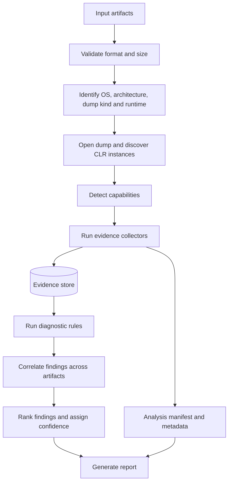

# DumpDoctor: .NET Dump Analyzer — Design Document

| | |
|---|---|
| **Status** | Draft v0.1 |
| **Document type** | Architecture and technical design |
| **Owner / reviewers** | _TBD_ |
| **Last updated** | 2026-10-13 |
| **Language** | C# |
| **Initial delivery** | .NET CLI (offline, local) |
| **Primary goal** | Analyze .NET dumps and supporting diagnostic artifacts to identify likely memory leaks, high CPU, ThreadPool starvation, deadlocks, hangs, and memory exhaustion |

> **Reading guide.** Sections marked **[MVP]** are in the first release. Everything else is planned but not committed. Items marked **Proposed default** are recommendations that still need sign-off (see §19).

---

## 1. Overview

DumpDoctor is a diagnostics-first .NET application that analyzes memory dumps, correlates runtime evidence, and produces actionable root-cause hypotheses.

It should help developers answer questions such as:

- Which object types retain the most managed memory, and why are they still reachable?
- Is the managed heap growing abnormally across snapshots?
- Which methods dominate CPU samples?
- Are ThreadPool workers blocked while queued work accumulates?
- Is memory pressure caused by managed heap growth, LOH, pinned objects, or native allocations?
- Are threads waiting on locks, tasks, semaphores, or other synchronization primitives?

A single dump is a snapshot, not a complete history. It can reveal retained objects, current thread stacks, and some synchronization state. Confirming a memory leak, sustained high CPU, or evolving ThreadPool starvation usually requires multiple dumps, runtime counters, or profiling traces.

### 1.1 Target users

| User | Typical need |
|---|---|
| Application developer | "Why is my service's memory growing?" — local triage with a clear next step |
| On-call / SRE engineer | Fast first-pass analysis of a production dump, often under time pressure and with limited debugger expertise |
| CI / automation | Regression gate: fail a pipeline if a load test produces a leak or blocking pattern (needs a stable JSON contract and exit codes) |

### 1.2 Success criteria

- A developer with no SOS/WinDbg experience can go from a dump to a ranked, evidence-backed finding in one command.
- For the sample scenarios in §17 (cache leak, sync-over-async starvation, controlled deadlock), the expected finding is produced with the expected evidence on every supported runtime/platform in the matrix.
- Reports never present a hypothesis as a proven conclusion and always state which evidence was missing.
- Analysis of a large dump stays within the resource budget in §14.

### 1.3 Design principles

1. **Reuse established diagnostic technology.** Do not implement a CLR dump parser from scratch.
2. **Evidence before conclusions.** Every finding must link to the evidence supporting it.
3. **Explain uncertainty.** A large cache is not automatically a leak; blocked workers do not automatically prove starvation.
4. **Modular analyzers.** Memory, CPU, threading, and runtime diagnostics should evolve independently.
5. **Offline-first and secure by default.** Dumps can contain secrets and application data; avoid external uploads by default, and treat dump files as untrusted input.
6. **Graceful degradation.** A missing symbol or failed analyzer should not invalidate all other results.
7. **Reproducible analysis.** Record artifact hashes, tool versions, runtime metadata, and rule versions.
8. **Interpretation is separate from collection.** Collectors gather facts; rules interpret them. Rules never touch a dump directly.

## 2. Goals and non-goals

### 2.1 Goals

| Goal | Release |
|---|---|
| Analyze managed .NET dumps on supported Windows and Linux environments | MVP |
| Inspect CLR heaps, object types, thread stacks, GC state, and basic synchronization clues | MVP |
| Generate JSON and human-readable Markdown reports | MVP |
| Provide a CLI suitable for local debugging and CI automation | MVP |
| Apply deterministic, explainable diagnostic rules | MVP (basic) → Phase 2 (full engine) |
| Compare multiple dumps to identify changes in heap composition | Phase 2 |
| Root paths, ThreadPool and lock analysis | Phase 2 |
| Accept profiling traces and runtime metrics for CPU and starvation diagnosis | Phase 3 |
| HTML report | Later |

### 2.2 Non-goals for the initial release

- Replacing WinDbg, LLDB, or other native debuggers.
- Parsing dump formats from scratch.
- Proving a memory leak from one snapshot.
- Reliably attributing historical CPU consumption from a dump alone.
- Automatically modifying, attaching to, or restarting the target process.
- Sending dump contents to an LLM or external service by default.
- Analyzing NativeAOT or Mono-runtime dumps (no CLR data access layer is available for them).
- Running as a multi-tenant service (see §19, decision 3).

## 3. Alternatives and prior art

The document should justify why DumpDoctor exists next to existing tools.

| Tool | What it does well | Gap DumpDoctor targets |
|---|---|---|
| `dotnet-dump analyze` + SOS | Authoritative, interactive, covers many scenarios | Expert-driven and manual; no correlation, ranking, or automation-friendly output |
| `dotnet-gcdump` | Lightweight heap snapshots and type diffs | No thread/lock analysis; no root-cause interpretation |
| WinDbg / LLDB + SOS | Full native + managed depth | Steep learning curve; not CI-friendly |
| PerfView / Visual Studio | Rich CPU and allocation analysis | GUI-centric; limited offline automation |
| Commercial profilers | Polished leak and CPU analysis | Licensing cost; often require live attach |

**Positioning:** DumpDoctor is an automated, explainable triage layer *on top of* ClrMD and standard tooling. It is not a replacement for them, and every finding should tell the user which standard tool command to use to dig deeper.

> _Reviewer action:_ validate this table against current tool capabilities before publishing; it is based on general knowledge rather than a fresh survey.

## 4. Inputs and capability model

### 4.1 Input artifacts

| Artifact | Format | Release |
|---|---|---|
| Process dump | `.dmp` (Windows), `.core` / ELF core (Linux) | MVP |
| Additional dumps for comparison | same | Phase 2 |
| EventPipe trace | `.nettrace` | Phase 3 |
| Runtime metrics | JSON/CSV with a documented, versioned schema | Phase 3 |
| Application logs | Free text | Not planned (remove from diagrams until an analyzer exists) |

### 4.2 Dump types and what they can support

The original draft did not distinguish dump types, but the available evidence depends on them. On Windows, minidumps, heap dumps, and full dumps contain different data. On Linux, createdump produces similar variants. Triage-style dumps may contain no managed heap at all.

At open time DumpDoctor must detect and record:

- Dump kind (minidump / heap / full / triage, as best it can be inferred) and whether the managed heap is enumerable.
- Whether thread stacks and the DAC are available.
- Capture time and its source (see §4.4).

### 4.3 Capability-to-evidence matrix and completeness score

Each collector declares the capabilities it needs; each rule declares the evidence kinds it needs. The orchestrator computes which rules are **runnable**, **degraded**, or **not possible**, and why.

| Rule family | Needs | Single full dump | + Multiple dumps | + Trace / metrics |
|---|---|---|---|---|
| Heap statistics, LOH (`MEM-003`) | Enumerable heap | ✔ | ✔ | ✔ |
| Retention (`MEM-002`) | Heap + roots | ✔ | ✔ | ✔ |
| Growth (`MEM-001`) | ≥ 2 comparable heaps | ✘ | ✔ | ✔ |
| Blocking stacks (`TP-002`), locks (`LOCK-001`) | Thread stacks, sync info | ✔ (partial) | ✔ | ✔ |
| Starvation (`TP-001`) | Queue/worker time series | partial (snapshot only) | partial | ✔ |
| CPU hot paths (`CPU-001/002`), GC cost (`GC-001`) | Samples / metrics | ✘ (current stacks only) | ✘ | ✔ |

**Diagnostic completeness** is defined as: `runnable rules / applicable rules` for the requested focus, reported together with the list of missing evidence and what artifact would provide it. It is a coverage indicator, **not** a confidence score for any finding.

### 4.4 Capture time and comparability

Growth rates (§11.3) need trustworthy capture times, but they are not guaranteed. A Windows dump header carries a timestamp; a Linux core file may only have a filesystem time that copying can alter.

- `ArtifactMetadata` records capture time **and its source** (`DumpHeader`, `FileSystem`, `UserSupplied`).
- Add `--captured-at` to override it.
- Growth *rates* from low-trust timestamps are flagged; growth *deltas* remain valid.

### 4.5 Capture guidance (shipped with the tool)

Findings are only as good as the dumps. The documentation should say how to capture comparable snapshots: same dump type, same workload phase, consistent warm-up, optionally forcing a GC beforehand, and at least three snapshots for trend detection.

### 4.6 Runtime and platform scope

To be fixed in the supported-runtime matrix (§19, decision 1). The matrix must separately state:

- **Host runtime:** what DumpDoctor itself runs on (proposed: .NET 10).
- **Analyzed runtimes:** which CLR versions it can inspect (for example .NET Framework 4.x vs. modern .NET), and whether analysis of a Linux dump on Windows (and the reverse) is supported.

## 5. Proposed architecture



### Component view

```text
Inputs
  ├── .dmp / .core
  ├── .nettrace            (Phase 3)
  └── Runtime metrics      (Phase 3)
        |
        v
Analysis Orchestrator
  ├── Artifact validation
  ├── Runtime/tool/capability discovery
  ├── Timeouts, cancellation, resource limits
  └── Collector and rule scheduling
        |
        +--> Evidence collectors: Memory | Threads | CPU/Trace | Runtime/GC
        |           (write normalized evidence to the Evidence Store)
        v
Evidence Store  (normalized, provenance-tagged, serializable)
        |
        v
Rule Engine + Correlation
  ├── Deterministic, pure rules over evidence
  ├── Cross-snapshot comparison
  ├── Severity and confidence
  └── Diagnostic completeness
        |
        v
Report Generator
  ├── JSON
  ├── Markdown
  └── HTML (later)
```

### Architectural boundaries

- **Core** owns domain models, collector and rule contracts, orchestration abstractions, evidence store, and findings.
- **Integrations** adapt ClrMD, SOS/`dotnet-dump`, EventPipe, and runtime counters into normalized evidence.
- **Collectors** gather domain-specific evidence. **Rules** interpret it.
- **Reporting** renders findings without embedding diagnostic logic.
- **CLI** handles arguments, exit codes, console UX, and output selection.

Core analyzers must not launch external processes or parse raw command output directly. Anything that does so lives in an integration project behind an interface.

### Evidence store persistence

Because rules operate on the evidence store rather than a live dump, the store can be serialized. This enables:

- Re-running or updating rules without re-opening a multi-GB dump.
- Unit-testing rules from small JSON fixtures instead of real dumps.
- Sharing a sanitized evidence bundle for support without sharing the dump itself.

## 6. Technology choices

| Concern | Proposed technology | Purpose |
|---|---|---|
| Application | C# / .NET 10 initially | CLI and orchestration |
| Managed dump inspection | `Microsoft.Diagnostics.Runtime` (ClrMD) | Programmatic CLR heap, object, and thread inspection **[MVP]** |
| SOS diagnostics | `dotnet-dump` and SOS commands | Supplementary; for cases ClrMD does not cover (Phase 2+) |
| CPU profiling | `dotnet-trace` / EventPipe | CPU samples and runtime events (Phase 3) |
| Runtime metrics | Files produced by `dotnet-counters` or `Microsoft.Diagnostics.NETCore.Client` | CPU, GC, allocation, ThreadPool time series (Phase 3) |
| Serialization | `System.Text.Json` | Structured output and manifests |
| Reporting | Markdown templates; HTML later | Human-readable results |
| Optional UI | Avalonia or ASP.NET Core | Future report viewer |

DumpDoctor consumes metrics/trace *files*. It does not attach to live processes, which keeps the MVP unprivileged.

### 6.1 DAC and symbol acquisition (new)

Opening a dump generally needs the matching CLR data access component (DAC), and sometimes symbols. This conflicts with a naive reading of "offline-first", so the policy must be explicit:

- **Default (`--offline`):** only use DAC/symbols found locally or in a configured cache or symbol path. If the DAC is missing, report a precise "unsupported / missing component" capability failure and the exact file needed.
- **Opt-in (`--allow-symbol-server`):** permit downloads from a configured symbol server. The report must record that network access occurred and which endpoint was used.
- **Security note:** the DAC is native code loaded into the DumpDoctor process; it must come from a trusted source and have its signature verified where the platform supports it.

### 6.2 SOS integration constraints (new)

`dotnet-dump analyze` is an interactive text tool, and its output is not a stable contract. To avoid brittle integration:

- **MVP uses ClrMD only.** Do not depend on SOS output parsing in the first release.
- Where SOS integration is added later, run it as a child process behind `IEvidenceCollector`, parse only well-defined output, pin the tool version, and cover each parser with golden-output tests.
- Prefer a ClrMD implementation over SOS parsing whenever one exists.

### 6.3 Build versus integrate

Use:
- **ClrMD** for structured managed dump inspection.
- **SOS** for established runtime diagnostics that are useful to reuse.
- **EventPipe and runtime metrics** for time-dependent behavior such as CPU hot paths and starvation.
- **DumpDoctor's own rules and correlation engine** for interpretation and actionable reports.

The product's value is the quality of its diagnosis, not reimplementing debugger functionality.

## 7. Diagnostic capabilities

### 7.1 Memory leak and heap growth

Capabilities:
- Summarize instance counts and shallow sizes by type.
- Identify large arrays, strings, collections, and LOH objects.
- Inspect GC roots and reference paths for selected objects.
- Compare type counts and sizes across dumps.
- Flag suspicious static references, event-handler retention, unbounded caches, pinned objects, finalizer queues, and assembly load contexts.

Design notes (new):

- **Live vs. dead objects.** A heap enumeration can include unreachable objects that the GC has not yet reclaimed. Statistics must say whether they cover *all* objects or only *reachable* ones; comparisons across dumps must use the same basis. Computing reachability requires a root traversal and costs more.
- **Retained size is not free.** ClrMD does not provide retained (dominator) sizes. Treat sizes in two tiers:
  - **MVP:** shallow size and instance counts per type, plus reference paths for selected objects.
  - **Phase 2:** retained-size estimates for bounded targets (top-N types or roots) using a compact object graph. A full dominator tree is a later optimization and needs the memory design in §14.
- Rules in §10 must say which tier they depend on.

Important caveats:
- A large type count is not proof of a leak.
- A large cache may be expected and bounded.
- A reference path proves reachability, not that the retention is incorrect.
- Snapshot comparisons are most meaningful when workload and capture conditions are comparable.

A stronger leak hypothesis combines persistent growth across multiple snapshots with a retention path and application context.

### 7.2 High CPU and excessive GC

Capabilities:
- Find hot methods from sampled CPU profiles.
- Group CPU samples by method and call stack.
- Correlate CPU usage with GC activity, allocation rate, and pause duration.
- Distinguish CPU saturation from a process that is slow but mostly waiting.

A dump captures current thread stacks and state; it usually cannot establish which methods consumed the most CPU over the preceding interval. Accept a `.nettrace` or another supported profiling artifact for reliable hot-path attribution.

### 7.3 ThreadPool starvation and blocked threads

Capabilities:
- Inspect managed thread stacks and ThreadPool state when available.
- Group workers with similar blocking stacks.
- Detect sync-over-async patterns such as `.Result` and `.Wait()`.
- Identify lock, semaphore, and synchronous I/O waits where evidence permits.
- Correlate queue length, worker count, completed work items, CPU, and throughput across time.

The strongest starvation diagnosis combines a dump with runtime metrics or wait-event traces. A single blocked stack is a clue, not proof of process-wide starvation.

### 7.4 OOM, deadlocks, and hangs

Capabilities:
- Investigate managed heap exhaustion and reported allocation failures where available.
- Compare managed heap size with process working set and private memory.
- Inspect GC configuration and any container/cgroup or heap hard limits visible in the dump (new): an "OOM" is often a limit mismatch rather than a leak.
- Inspect native stacks and native allocation clues using platform-specific tooling.
- Identify lock ownership and wait relationships where the dump contains enough information.
- Inspect GC handles, pinned objects, finalizer queues, and collectible assembly load contexts.

Native memory and OS-level deadlocks may require a native debugger or platform-specific diagnostics in addition to managed dump analysis.

## 8. Evidence model

All collectors normalize data into shared records.

| Model | Key fields |
|---|---|
| `ArtifactMetadata` | Artifact ID, path/name, hash, capture time **and source**, dump kind, runtime, OS, architecture |
| `HeapTypeStat` | Type name, instance count, shallow size, basis (all vs. reachable) |
| `HeapObject` | Address, type, size, generation |
| `ReferencePath` | Root, reference chain, target object |
| `ThreadSnapshot` | OS thread ID, managed thread ID, stack frames, state |
| `ThreadPoolSnapshot` | Worker count, queue length, available workers, when exposed |
| `GcSnapshot` | GC mode (workstation/server, concurrent), heap count, configured limits, generation sizes |
| `CpuSample` | Method, stack, sample count, estimated weight |
| `RuntimeMetric` | Timestamp, metric name, value, unit |
| `DiagnosticFinding` | Rule ID and version, title, summary, severity, confidence, evidence references, limitations, recommendations |

Every evidence item must include provenance:
- Source artifact and collector.
- Runtime and tool version where relevant.
- Collection timestamp or snapshot identity.
- Units and interpretation notes.
- Whether the value is directly observed or derived.

Evidence items have stable IDs so that findings can reference them and reports can link back to them.

Avoid storing raw object contents unless specifically required. Object addresses and sensitive values should not be emitted unnecessarily (see §15).

## 9. Collector, rule, and finding contracts

The original sketch put evidence collection and interpretation behind one interface, which contradicts principle 8. The revised contract splits them:

```csharp
// Collectors do the (slow, I/O-heavy) work and may touch dumps and tools.
public interface IEvidenceCollector
{
    string Id { get; }
    CapabilityRequirements Requires { get; }

    Task CollectAsync(
        AnalysisContext context,
        IEvidenceSink sink,
        CancellationToken cancellationToken);
}

// Rules are pure, deterministic, and testable from evidence fixtures alone.
public interface IDiagnosticRule
{
    string Id { get; }
    Version Version { get; }
    IReadOnlySet<EvidenceKind> RequiredEvidence { get; }

    IReadOnlyList<DiagnosticFinding> Evaluate(
        IEvidenceStore evidence,
        RulePolicy policy);
}

public enum Severity   { Informational, Low, Medium, High, Critical }
public enum Confidence { Low, Medium, High }
public enum Provenance { Observed, Derived }

public sealed record EvidenceItem(
    EvidenceId Id,
    EvidenceKind Kind,
    string Description,
    ArtifactId? Artifact,
    string CollectorId,
    Provenance Provenance,
    string? MetricName,
    double? Value,
    string? Unit);

public sealed record DiagnosticFinding(
    string RuleId,
    Version RuleVersion,
    string Title,
    string Summary,
    FindingCategory Category,
    Severity Severity,
    Confidence Confidence,
    IReadOnlyList<EvidenceId> Evidence,
    IReadOnlyList<string> Limitations,
    IReadOnlyList<string> Recommendations,
    IReadOnlyList<FindingId> RelatedFindings);
```

Changes from the original sketch:

- Findings reference evidence by ID, so evidence is stored once and linked many times.
- `Limitations` and `RelatedFindings` now exist in the record; the original "finding shape" list had them but the record did not.
- `Severity` and `Confidence` are enums. The original `string` severity and `double` confidence invited inconsistent values and false precision.
- `AnalysisContext` must be defined before implementation. At minimum it exposes artifact metadata, detected capabilities, configuration, a logger, and the time budget. It must **not** expose raw dump access to rules.

### 9.1 Severity and confidence are different things

- **Severity** is the potential *impact* if the hypothesis is true (for example a deadlock in a request path is High; a large-but-bounded LOH footprint is Low).
- **Confidence** is how strongly the *available evidence* supports the hypothesis.

Confidence rubric (proposed):

| Level | Criteria |
|---|---|
| **High** | All required signals directly observed **and** at least one independent corroborating source (second snapshot, trace, or counters) |
| **Medium** | All required signals observed from a single source or single snapshot |
| **Low** | Only some required signals present, or key signals are derived/inferred |

Rules may use an internal numeric score, but reports show the label plus the *reasons* it was assigned and what would raise it. Numeric scores that cannot be explained should not be shown.

### 9.2 Finding shape

Each rendered finding includes:
1. **Title:** concise issue statement.
2. **Severity:** informational, low, medium, high, or critical.
3. **Confidence:** label and the reasons behind it.
4. **Summary:** what was observed and why it matters.
5. **Evidence:** specific metrics, types, stacks, roots, or trace samples, each linked by ID.
6. **Limitations:** missing data or alternative explanations.
7. **Recommended actions:** practical next steps to confirm or remediate, including the standard-tool command to dig deeper.
8. **Related findings:** other observations that strengthen or weaken the hypothesis.

### 9.3 Rule engineering requirements

- Deterministic: same evidence + same policy → same findings, in the same order.
- Independently testable from evidence fixtures (no dump needed).
- Versioned; rule ID and version appear in every finding and in the manifest.
- Declare required evidence so the orchestrator can mark them runnable, degraded, or not possible (§4.3).
- Never emit a finding when required evidence is absent; emit a "could not evaluate" note in the completeness section instead.

## 10. Initial diagnostic rules

| Rule ID | Detection logic | Required evidence | Caveats |
|---|---|---|---|
| `MEM-001` | Significant, persistent growth in bytes **or instance count** for a type across ≥ 2 snapshots (≥ 3 preferred) | Heap stats from comparable snapshots | Growth can be legitimate; MVP uses shallow size, retained size from Phase 2 |
| `MEM-002` | Large object graph reachable from a long-lived root (static, singleton, cache-like collection) | Heap + GC roots + reference paths | Strong retention evidence, not automatically a leak. "Cache-like" must be defined by explicit heuristics (known cache/collection types, static roots) and listed in the finding |
| `MEM-003` | Large LOH or pinned-object footprint | Heap + GC handles | May be expected for buffers and high-throughput workloads |
| `MEM-004` | _(candidate)_ Large finalizer queue / objects pending finalization | Finalizer queue | May be transient at capture time |
| `CPU-001` | Methods dominate CPU samples in a time-windowed profile | Trace | Requires profiling data |
| `CPU-002` | Repeated hot stacks combined with sustained CPU saturation | Trace or counters + stacks | A dump alone cannot establish historical CPU use |
| `TP-001` | Many blocked workers, growing queue, rising worker count | ThreadPool time series + stacks | Stronger with time-series metrics; snapshot-only is Low confidence |
| `TP-002` | Repeated synchronous waits on async operations | Thread stacks | Indicates a blocking pattern; impact depends on workload |
| `LOCK-001` | Threads wait on a lock owned by another thread; report cycles as deadlock candidates | Thread stacks + sync info | Requires sufficient lock and thread information |
| `GC-001` | High GC time, frequent collections, allocation pressure | Metrics or trace | Requires runtime metrics or trace evidence |
| `GC-002` | _(candidate)_ GC configuration or container/heap limit inconsistent with observed heap | GC snapshot | Needs reliable limit information in the dump |
| `OOM-001` | Evidence of heap exhaustion or a recent allocation failure | Exception/GC state | Does not explain every OS-level OOM |

Policy rules:
- Rules must not rely on universal hard-coded thresholds alone. Support configurable policies and contextual signals such as processor count, runtime version, workload, and baseline behavior.
- Every threshold used in a finding is printed in that finding, so users can see why it fired and tune it.
- Ship a documented default policy and a `--config` override; changes to defaults are versioned like rule changes.

## 11. Correlation examples

### 11.1 Suspected unbounded cache growth

Observed evidence:
- Managed heap is large.
- Cache-related object counts and sizes grow across comparable snapshots.
- Objects remain reachable from a long-lived cache or singleton.

Finding:
- **Hypothesis:** Suspected unbounded cache growth.
- **Evidence:** Type and size deltas across snapshots; reference path to long-lived cache.
- **Confidence:** High for the retention mechanism; leak conclusion depends on intended cache behavior.
- **Next steps:** Inspect expiration and eviction policies; repeat measurement after workload stabilization.

### 11.2 Suspected ThreadPool starvation

Illustrative signals:
- Worker count rises over time.
- Queue length increases.
- CPU remains below saturation.
- Many worker stacks show similar synchronous waits.

Finding:
- **Hypothesis:** ThreadPool starvation caused by blocked workers.
- **Next steps:** Group similar stacks; inspect `.Result`, `.Wait()`, synchronous I/O, and lock contention; corroborate with runtime counters and wait-event traces.

These are examples, not fixed thresholds or measured results.

### 11.3 Memory growth metrics

For type `T` in snapshots 1 and 2:

`DeltaBytes(T) = Bytes(T, snapshot2) − Bytes(T, snapshot1)`

`GrowthRate(T) = DeltaBytes(T) / (time2 − time1)`

Rank types by absolute growth and growth rate, and:

- Use the **same basis** (all vs. reachable objects) and the same size tier (shallow vs. retained) in both snapshots.
- Normalize for workload where a throughput figure is available (for example bytes per 1,000 requests); otherwise state that the rate is unnormalized.
- Flag the rate as low-trust if capture times come from the filesystem (§4.4).
- With three or more snapshots, fit a trend (for example a monotonic-increase check or a linear fit) rather than extrapolating from two points, and show the points.
- Also consider instance count, retention paths, workload differences, and GC behavior.

## 12. CLI design

Proposed command examples:

```bash
# Analyze one dump
dumpdoctor analyze ./app.dmp

# Focus on memory
dumpdoctor analyze ./app.dmp --focus memory

# Compare snapshots (two or more, in capture order)
dumpdoctor compare ./t0.dmp ./t1.dmp ./t2.dmp

# Combine dump and profiling evidence (Phase 3)
dumpdoctor analyze ./app.dmp \
  --trace ./cpu-profile.nettrace \
  --metrics ./runtime-metrics.json

# Export structured results
dumpdoctor analyze ./app.dmp --format json --output ./report.json

# Generate a Markdown report
dumpdoctor analyze ./app.dmp --format markdown --output ./report.md
```

These are proposed interfaces, not an existing executable.

### 12.1 Commands

| Command | Purpose | Release |
|---|---|---|
| `analyze` | Run collectors and rules on one dump (plus optional trace/metrics) | MVP |
| `inspect` | Print raw normalized evidence (heap stats, threads, GC) without rules; for debugging and support | MVP |
| `compare` | Compare ≥ 2 dumps in capture order | Phase 2 |
| `rules list` | List rules, versions, required evidence, default thresholds | MVP |

### 12.2 Options

| Option | Meaning |
|---|---|
| `--focus <memory\|threads\|cpu\|all>` | Restrict collectors and rules (default `all`) |
| `--format <json\|markdown>` | Output format; `--output` selects the path (default stdout) |
| `--trace`, `--metrics` | Additional artifacts (Phase 3) |
| `--config <file>` | Policy and rule overrides (schema documented and versioned) |
| `--timeout <duration>` | Per-analyzer and overall limits |
| `--max-artifact-size`, `--max-memory` | Resource limits (see §14) |
| `--offline` (default) / `--allow-symbol-server` | DAC/symbol acquisition policy (see §6.1) |
| `--captured-at <timestamp>` | Override capture time per dump (see §4.4) |
| `--redact <strict\|standard\|none>` | Report redaction level (see §16) |
| `--fail-on <severity>` | Exit non-zero if a finding at or above this severity exists (CI gates) |
| `--verbose` | Detailed logging |

### 12.3 Exit codes (proposed)

| Code | Meaning |
|---|---|
| 0 | Completed; no finding at or above `--fail-on` |
| 1 | Completed; at least one finding at or above `--fail-on` |
| 2 | Invalid arguments or configuration |
| 3 | Input artifact missing, corrupt, or unsupported |
| 4 | Partial result: one or more collectors/rules failed or timed out (report still written) |
| 5 | Unexpected internal error |
| 130 | Cancelled by the user |

Exit codes become part of the public contract once released; do not change them without a major version bump.

### 12.4 CLI requirements

- Stable exit codes for automation.
- Cancellation support.
- Progress reporting for expensive stages, written to stderr so stdout stays machine-readable.
- Per-collector error isolation.
- A diagnostic completeness summary showing which analyses were possible and which evidence was missing (§4.3).

A dump-only run may fully analyze heap statistics but lack enough evidence for historical CPU attribution. The report should state that explicitly.

## 13. Repository structure

For the MVP, keep the number of projects small. Splitting along every analyzer boundary up front adds friction without benefit; split later when a boundary proves its worth. The original structure is retained as the **target** layout.

### MVP layout

```text
src/
  DumpDoctor.Cli/
  DumpDoctor.Core/             # models, contracts, orchestration, evidence store, rule engine
  DumpDoctor.Collectors/       # memory + thread collectors (folders per domain)
  DumpDoctor.Rules/            # MVP rules (folders per domain)
  DumpDoctor.Integrations.ClrMD/
  DumpDoctor.Reporting/        # JSON + Markdown

tests/
  DumpDoctor.Core.Tests/
  DumpDoctor.Rules.Tests/      # evidence-fixture tests, no dumps
  DumpDoctor.IntegrationTests/ # real dumps from samples

samples/
  MemoryLeakApp/
  ThreadStarvationApp/
  DeadlockApp/
```

### Target layout (as the product grows)

```text
src/
  DumpDoctor.Cli/
  DumpDoctor.Core/
  DumpDoctor.Analyzers.Memory/     (HeapStatistics, ObjectRetention, SnapshotComparison)
  DumpDoctor.Analyzers.Threads/    (ThreadStacks, ThreadPool, Locks)
  DumpDoctor.Analyzers.Cpu/        (CpuSamples, HotPaths)
  DumpDoctor.Analyzers.Runtime/    (GcState, GcCorrelation)   <- was shown in the component view but missing here
  DumpDoctor.Integrations.ClrMD/
  DumpDoctor.Integrations.DotNetDump/
  DumpDoctor.Integrations.EventPipe/
  DumpDoctor.Reporting/            (Markdown, Html, Json)
```

Dependency rules:
- Core must not depend on the CLI or on any integration.
- Rules depend only on Core (evidence models), never on ClrMD.
- Reporting consumes normalized analysis results rather than raw diagnostic tool output.

## 14. Performance and scalability (new)

The original document listed what to measure but set no budget. Production dumps are routinely multi-GB, so this has to drive design, not follow it.

### 14.1 Design implications

- **Stream, don't materialize.** Enumerate the heap once, aggregate into per-type counters and top-N structures, and avoid holding a `HeapObject` per object.
- **Compact graph representation for root/retention work.** If reachability or retained-size computation is needed, use compact arrays (for example address-to-index maps and adjacency in integer arrays) and bound the work to selected types or roots.
- **Cache the heap index** (optionally, on disk, keyed by artifact hash) so re-runs and `compare` do not repeat a full enumeration.
- **Bounded concurrency.** Default to analyzing one large dump at a time (§15).
- **Hashing cost.** Streaming SHA-256 over a very large dump is expensive; make it incremental and overlap it with analysis, or allow `--no-hash` with a manifest note.
- Treat object enumeration cost as a user-visible stage with progress and cancellation.

### 14.2 Targets

Targets should be set after a short benchmark spike on representative dumps. Until then, the document commits only to:

- A **memory budget** option (`--max-memory`) that analyzers must respect, degrading gracefully (for example sampling or top-N only) and recording what was skipped.
- A documented **time and peak-memory profile** per dump size class (for example 1 GB, 10 GB, 50 GB) published with each release, produced by the performance tests in §17.
- No analysis stage may be unbounded in time: each has a timeout and a partial-result path.

## 15. Execution, compatibility, security, and privacy

### 15.1 Process isolation and resource limits

- Run external tools as child processes with timeouts and captured standard output/error.
- Pass arguments as argument arrays, never by concatenating shell strings (artifact paths may contain anything).
- Bound analysis concurrency and configure maximum artifact size.
- Support cancellation and terminate child processes when safe.
- Avoid loading multiple large dumps concurrently by default.
- Record partial results if a collector or rule times out or fails.

### 15.2 Runtime and platform compatibility

- Detect OS, architecture, CLR version, dump kind, and available DAC/debugging components.
- Record compatibility failures and unsupported capabilities with the exact missing component.
- Distinguish managed analysis from native debugging.
- Test against a documented matrix of supported runtime versions and platforms (§19, decision 1).
- Clearly reject unsupported runtimes (for example NativeAOT) rather than producing misleading partial output.

### 15.3 Dump files are untrusted input (new)

Dumps may come from other machines, customers, or compromised hosts, and they are large, complex binary formats.

- Parse defensively: a malformed dump must produce a clean error (exit code 3), never a crash, hang, or unbounded allocation.
- Enforce limits on object counts, string lengths, stack depth, and graph size when reading structures from the dump.
- Fuzz or corpus-test malformed and truncated dumps (§17).
- Do not execute or load modules found *inside* the dump. Only load DAC components from approved locations (§6.1).

### 15.4 Privacy

- Treat dump files as sensitive; they may contain credentials, tokens, personal information, and application payloads.
- Keep processing local by default.
- Do not upload dumps or object contents to external services without explicit opt-in.
- Avoid emitting raw object values, secrets, or unnecessary memory addresses in reports.
- Be aware that **type names, method names, and file paths can themselves be sensitive** (customer-specific or internal names); see redaction levels in §16.
- Sanitize paths and command output where appropriate.
- Set restrictive permissions on output files, evidence bundles, caches, and temp files, and clean up temp files on exit and on cancellation.
- Document that external diagnostic tools execute with the application's OS-level permissions.

### 15.5 Reproducibility

Persist an analysis manifest containing:
- Artifact hashes and metadata (including capture-time source).
- Tool and runtime versions, including DAC version used.
- Collector, rule, and policy versions.
- Configuration and enabled rules.
- Network access performed, if any (§6.1).
- Start/end timestamps and analyzer failures.
- Report schema version.

Determinism applies to **findings given the same evidence**. Timestamps and durations in the manifest are expected to differ between runs and are excluded from comparisons.

## 16. Report design (new)

- **Schema:** JSON reports carry a `schemaVersion`. Document whether the schema is a stable public API for CI use (§19, decision 4); if so, define the compatibility policy (additive changes only within a major version).
- **Ordering:** findings sorted by severity, then confidence, then rule ID, for determinism.
- **Required sections:** summary and top findings; per-finding detail (§9.2); diagnostic completeness and missing evidence; environment/manifest; limitations.
- **Redaction levels:**
  - `strict`: no addresses, no object values, hashed or generalized paths; type and method names kept only for framework/BCL types.
  - `standard` (proposed default): no object values, addresses shortened or omitted; application type/method names shown.
  - `none`: everything the collectors gathered except raw object contents. Requires explicit opt-in.
- **Evidence bundle (optional):** export of the evidence store at the chosen redaction level for support or offline re-analysis without the dump.

## 17. Testing strategy

### 17.1 Unit tests

- Rule thresholds and boundary conditions, using **evidence fixtures** (no dumps needed, thanks to the §9 split).
- Confidence and severity calculations against the rubric.
- Snapshot delta calculations, including basis mismatches and low-trust timestamps.
- Evidence correlation.
- Report serialization, redaction, and schema stability.

### 17.2 Integration tests

Build sample .NET applications that intentionally reproduce:
- Retained-object growth / unbounded cache.
- ThreadPool blocking and sync-over-async.
- CPU-intensive loops.
- Large allocations and LOH pressure.
- Lock contention and a controlled deadlock.

Capture dumps and traces from these applications, then verify that the analyzer produces expected evidence and findings.

Practical constraints to plan for:
- Real dumps are large and OS-specific. Prefer **generating dumps in CI** (per OS/runtime in the matrix) over committing them; keep only small sanitized dumps in the repo, using Git LFS or an artifact store if needed.
- Dump-based tests can be slow and flaky (timing, GC state). Use deterministic triggers (explicit synchronization before capture, forced GC where relevant) and assert on stable properties, not exact counts.
- Run the full matrix on a schedule and a reduced set on every PR.

### 17.3 Regression tests

- Keep a small, sanitized corpus of test artifacts for supported runtimes.
- Compare stable output fields rather than brittle absolute addresses.
- Version report schemas, rules, and default policies.
- Include malformed, truncated, incomplete, and unsupported dump cases (also serving §15.3).
- Add golden-output tests for any SOS output parser (§6.2).

### 17.4 Performance tests

Measure:
- Time to open a dump.
- Time and peak memory for heap enumeration, by dump size class.
- Time for root-path searches.
- Cost of comparing multiple snapshots.
- Report generation time.
- Behavior under cancellation and resource limits.

Track results over time and fail CI on significant regressions once baselines exist (§14.2).

## 18. Implementation roadmap

Each phase has exit criteria so "done" is testable.

### Phase 1 — Dump inspection MVP

- CLI, artifact validation, capability detection, DAC/symbol policy.
- ClrMD integration and runtime discovery.
- Heap statistics (with live/dead basis), large objects, GC state, thread stacks.
- Basic rules: `MEM-003`, `TP-002`, and `inspect`/`rules list`.
- JSON and Markdown reports with manifest and completeness summary.

**Exit criteria:** sample apps' dumps analyzed correctly on all matrix entries; malformed dumps fail cleanly; resource limits honored on a large dump; exit codes implemented.

### Phase 2 — Root-cause analysis

- Object reference paths and selected-object GC roots.
- Retained-size estimates for bounded targets.
- ThreadPool and lock analysis (`LOCK-001`).
- Multi-dump heap comparison (`MEM-001`), `MEM-002`.
- Explainable rule engine, policies, and confidence scoring.

**Exit criteria:** cache-leak and deadlock samples yield the expected High/Medium-confidence findings with evidence links; snapshot comparison behaves correctly with mismatched bases.

### Phase 3 — CPU and runtime correlation

- `.nettrace` integration, CPU hot-path analysis.
- GC and allocation correlation.
- Runtime metrics and ThreadPool starvation detection (`TP-001`, `CPU-*`, `GC-001`).

**Exit criteria:** starvation and high-CPU samples diagnosed with trace/metrics; documented metric schema.

### Phase 4 — Advanced diagnostics

- Cross-snapshot trend detection.
- Native memory investigation integrations.
- Historical baselines and configurable policies.
- Optional LLM-generated explanations grounded in verified evidence, with redaction applied and explicit opt-in.
- Optional desktop UI or web report viewer; HTML report.

### 18.1 Recommended MVP scope

Build DumpDoctor as a focused diagnostic CLI with three initial strengths:

1. **Memory analysis:** heap statistics, large objects, and (in Phase 2) retention paths and dump comparisons.
2. **Thread analysis:** managed thread stacks, repeated blocking patterns, ThreadPool state, and lock information (the latter two growing in Phase 2).
3. **Evidence-driven reporting:** findings that explain the suspected problem, show supporting evidence, state uncertainty, and recommend the next diagnostic action.

Add trace analysis for CPU profiling and intermittent starvation scenarios after the dump analysis foundation is stable.

This scope creates a useful, testable core without requiring a privileged agent or production runtime attachment in the first release.

## 19. Key decisions to resolve before implementation

| # | Decision | Proposed default | Status |
|---|---|---|---|
| 1 | Supported runtime matrix (host runtime; analyzed CLR versions incl. .NET Framework; OS/arch; cross-OS analysis) | Host .NET 10; analyze currently supported modern .NET on Windows/Linux x64 and arm64; .NET Framework out of MVP | Open |
| 2 | Input scope for MVP | Dumps only; `.nettrace` and metrics in Phase 3 | Proposed |
| 3 | Execution model | Local CLI; no queueing service | Proposed |
| 4 | Is JSON a stable public API? | Yes, versioned from first release | Open |
| 5 | Native diagnostics in scope | Detect and report native-memory indicators only; no native debugging | Proposed |
| 6 | Distribution | `dotnet tool` (NuGet) first; self-contained executable later | Open |
| 7 | DAC/symbol policy | Offline by default; symbol server opt-in (§6.1) | Proposed |
| 8 | Size tier for MVP memory rules | Shallow size + counts; retained size in Phase 2 (§7.1) | Proposed |
| 9 | Default redaction level | `standard` (§16) | Proposed |
| 10 | Licensing and third-party notices (ClrMD, DAC redistribution) | To be reviewed | Open |

Recommended default overall: local CLI, offline-first, JSON + Markdown reports, ClrMD for managed inspection, SOS as a supplementary integration, and trace/metrics support in a subsequent phase.

## 20. Risks

| Risk | Impact | Mitigation |
|---|---|---|
| Missing DAC / symbols for the dump's runtime | Analysis cannot open or is degraded | Capability detection, clear error naming the missing file, opt-in symbol server |
| Large dumps exhaust memory or time | Tool unusable on real production dumps | Streaming design, resource limits, benchmark spike early (§14) |
| Findings over-claim | Loss of user trust | Confidence rubric, limitations section, evidence-linked findings, calibration against sample apps |
| Brittle integration with tool output | Breakage on tool updates | ClrMD-first; pin versions; golden tests (§6.2) |
| Sensitive data leaks through reports | Security/privacy incident | Redaction levels, restricted file permissions, no raw values by default |
| Flaky dump-based tests | Slow or ignored CI | Deterministic capture, stable-property assertions, evidence-fixture rule tests |
| Scope creep into native debugging | MVP delay | Explicit non-goal; detect and refer to WinDbg/LLDB |
